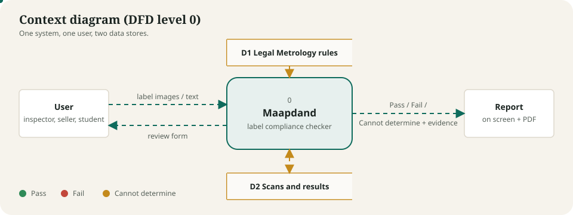
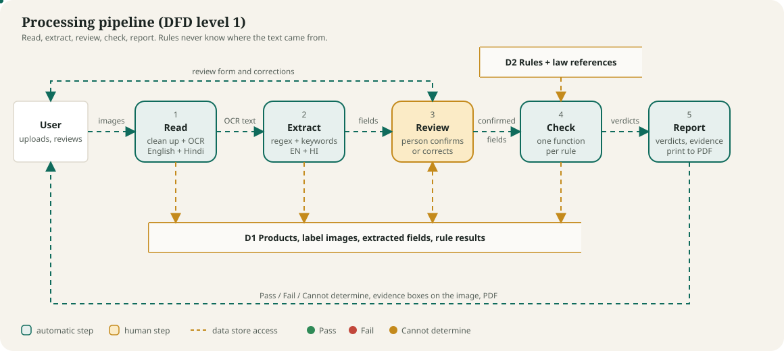

# Maapdand

**Checks packaged-product labels against India's Legal Metrology (Packaged Commodities) Rules, 2011.**

Upload photos of a pack (or paste its label text) and Maapdand returns a verdict for each rule: **Pass**, **Fail** or **Cannot determine**. Every verdict comes with evidence drawn on the label image and a reference to the clause it was checked against.

> Maapdand is a screening aid, not a legal determination. A person reviews the extracted fields before any verdict is final, and when the evidence is unclear the answer is *Cannot determine*, never a guessed pass.

Built for Smart India Hackathon 2026 (problem statement SIH26034) with Django.

## How it works

```
INPUT (images / text) -> READ (clean up + OCR, English and Hindi) -> EXTRACT (regex + keywords)
  -> REVIEW (a person confirms or corrects) -> CHECK (one function per rule) -> REPORT (verdicts, evidence, PDF)
```

### Context diagram (DFD level 0)



### Processing pipeline (DFD level 1)



## Features

- **Multi-image products.** A product is a set of images (front, back, sides). A field found in any image counts.
- **OCR in English and Hindi.** Tesseract with image clean-up and a quality gate that rejects blurry or tiny photos.
- **Paste-text mode.** Check label text directly, no image needed.
- **Human review step.** Extracted fields are shown for correction before the rules run.
- **Three-state verdicts with evidence.** Boxes are drawn on the image where each field was found, and missing fields are called out.
- **Printable report.** A clean report page that prints to PDF, plus a history of earlier scans.
- **Rule browser and source documents.** Every rule is listed with its verified clause, and the gazette PDFs can be opened from the app.
- **Evaluation command.** Scores the rules against a labelled set of cases.

## Rules checked

| Code | Rule |
|---|---|
| R01 | Manufacturer / packer / importer name and address |
| R02 | Common or generic name |
| R03 | Net quantity declared |
| R04 | Net quantity in standard units |
| R05 | Month and year of manufacture |
| R06 | MRP inclusive of all taxes |
| R07 | Consumer care details |
| R08 | Country of origin (imported products) |
| R09 | Unit sale price |
| R10 | Best before / use by date |
| M01 | Letter and numeral height (needs the physical pack) |
| M02 | Declarations on the principal display panel (needs the physical pack) |

M01 and M02 cannot be judged from a photo alone, so they never decide the overall verdict.

## Tech stack

- Python 3.14, Django 6.1
- SQLite
- Tesseract OCR via `pytesseract`, Pillow for image handling
- Plain HTML, CSS and a little JavaScript (GSAP and Lenis for motion), no front-end build step

## Getting started

These steps are for Windows with PowerShell.

1. **Install prerequisites**
   - [Python 3.14](https://www.python.org/downloads/)
   - [Tesseract OCR](https://github.com/UB-Mannheim/tesseract/wiki) (default path `C:\Program Files\Tesseract-OCR\tesseract.exe`)

2. **Clone and create a virtual environment**

   ```powershell
   git clone https://github.com/Aditya-Sh9/Maapdand.git
   cd Maapdand
   python -m venv .venv
   .venv\Scripts\Activate.ps1
   pip install -r requirements.txt
   ```

3. **Add the OCR language files.** Download `eng.traineddata` and `hin.traineddata` from [tessdata_fast](https://github.com/tesseract-ocr/tessdata_fast) into a `tessdata/` folder at the project root.

4. **Configure the environment.** Copy `.env.example` to `.env` and set a real `SECRET_KEY`. Optional settings: `TESSERACT_CMD` (if Tesseract is installed elsewhere) and `OCR_LANGUAGES` (default `eng+hin`).

5. **Create the database and run**

   ```powershell
   python manage.py migrate
   python manage.py runserver
   ```

   Open <http://127.0.0.1:8000/>. The rules are seeded by migrations, so there is nothing else to load.

## Tests and evaluation

```powershell
python manage.py test                       # unit and flow tests
python manage.py evaluate --errors          # score the rules on evaluation/data/cases.csv
python manage.py evaluate --real-only       # only real label photos
python manage.py evaluate --save            # write a report to evaluation/results/
```

The bundled cases are synthetic labels that each break one rule. They prove the rule logic, not accuracy on real packs. See [evaluation/data/README.md](evaluation/data/README.md) for how to add real photos.

## Project layout

| Folder | What it holds |
|---|---|
| `maapdand/` | Project settings and root URLs |
| `core/` | Landing page and UI template tags (icons, verdict chips, stepper, evidence box) |
| `scans/` | Product, image, scan and extracted-field models; upload, review, result, report and history views |
| `extraction/` | Extractor interface, text and OCR extractors, preprocessing, parsers, EN + HI keyword dictionary |
| `rules/` | Rule models, one function per rule, units, registry, engine, verdict logic, rule browser, documents |
| `evaluation/` | Labelled cases, scoring runner and the `evaluate` command |
| `templates/`, `static/` | Base layout, shared partials, CSS, JavaScript, fonts |

### Design choices

- The extractor is an interface (`BaseExtractor.extract(...)`), so rules never know whether text came from OCR or was typed in.
- One rule is one small, plainly named function, registered by code. The database row only holds metadata, the on/off switch and severity.
- The overall verdict is cautious: any Fail gives Fail, and any doubt gives Cannot determine.

## Limitations

- Not a legal opinion. It checks what is visible on the label against the rules it knows.
- OCR quality depends on the photo. Hindi reading is weaker than English.
- Category-specific rules (for example FSSAI marks or the vegetarian symbol) are not covered yet.
- Accuracy numbers on real packs are still to be collected; current evaluation data is synthetic.
